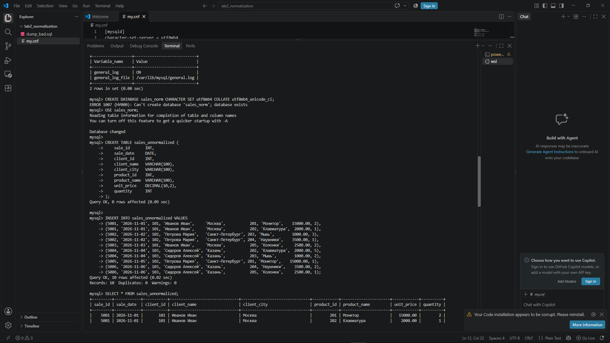
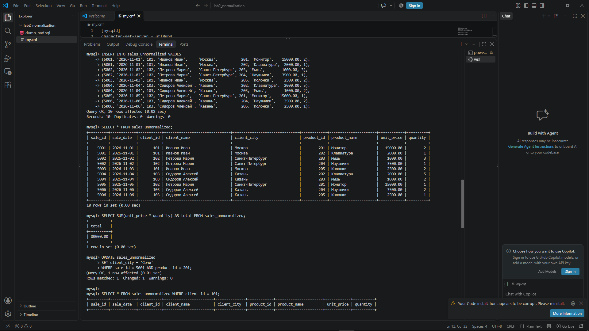
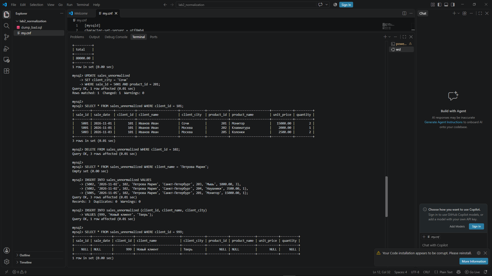
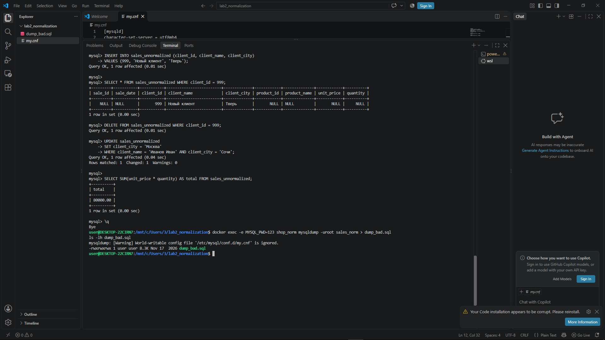
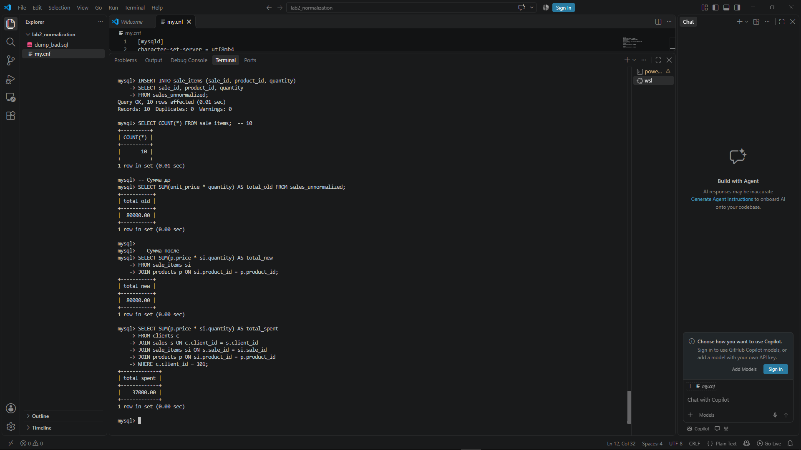
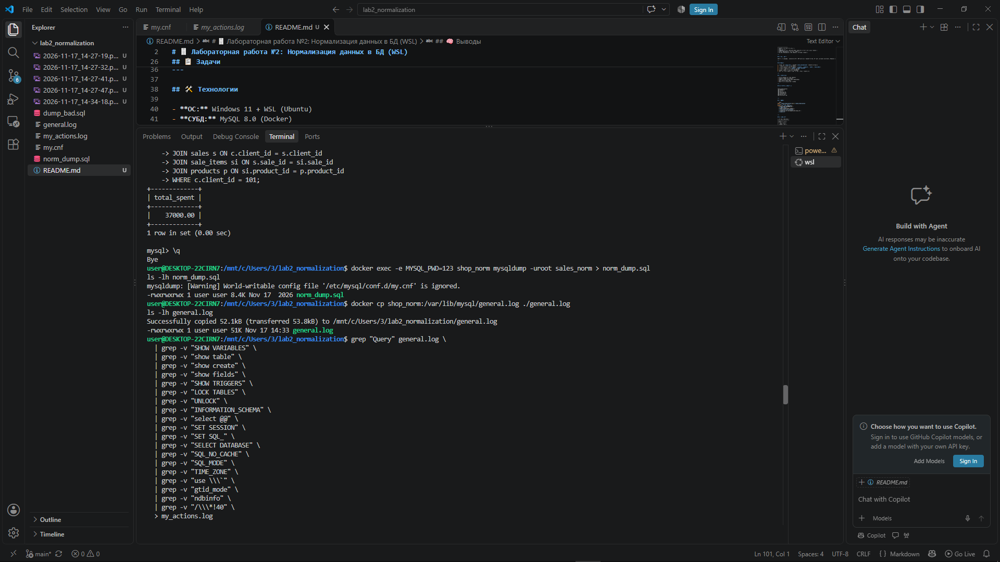

# 🗄️ Лабораторная работа №2: Нормализация данных в БД (WSL)

Нормализация таблицы продаж `sales_unnormalized` до 3NF в среде WSL (Ubuntu) с Docker и MySQL 8.0.

---

## 👨‍🎓 Информация о студенте

| Поле | Значение |
|------|----------|
| **ФИО** | Котохин Артём Ильич |
| **Курс** | 2 |
| **Специальность** | 09.02.07 «Информационные системы и программирование» |
| **Дата выполнения** | 17 ноября 2026 г. |
| **Среда выполнения** | WSL (Ubuntu) + VS Code + Docker |

---

## 🎯 Цель работы

Изучить нормализацию реляционной БД до 3NF на примере таблицы продаж, устранить аномалии обновления, удаления и вставки, освоить работу в среде WSL.

---

## 📋 Задачи

1. Создать БД `sales_norm` и таблицу `sales_unnormalized` в Docker-контейнере
2. Продемонстрировать три аномалии
3. Привести данные к 3NF — 4 таблицы (`clients`, `products`, `sales`, `sale_items`)
4. Перенести данные через `INSERT ... SELECT DISTINCT`
5. Проверить целостность (сумма 80 000.00)
6. Сделать дампы до и после нормализации
7. Настроить логирование и экспортировать отфильтрованный лог

---

## 🛠️ Технологии

- **ОС:** Windows 11 + WSL (Ubuntu)
- **СУБД:** MySQL 8.0 (Docker)
- **IDE:** Visual Studio Code (Remote-WSL)
- **Терминал:** Bash (WSL)
- **Контроль версий:** Git + GitHub

---

## 📁 Структура репозитория

```
lab2_normalization/
├── README.md
├── my.cnf
├── dump_bad.sql
├── norm_dump.sql
├── general.log
└── my_actions.log
```

---

## 🚀 Запуск

```bash
mkdir ~/lab2_normalization && cd ~/lab2_normalization
# Создать my.cnf, затем:
docker run --name shop_norm \
  -e MYSQL_ROOT_PASSWORD=123 \
  -e LANG=C.UTF-8 \
  -e MYSQL_INITDB_SKIP_TZINFO=1 \
  -v mysql_data:/var/lib/mysql \
  -v $(pwd)/my.cnf:/etc/mysql/conf.d/my.cnf \
  -d mysql:8.0
```

---

## 📊 Результаты

| Метрика | Значение |
|---------|----------|
| Клиентов | 3 ✅ |
| Товаров | 5 ✅ |
| Продаж | 6 ✅ |
| Позиций | 10 ✅ |
| Общая сумма | 80 000.00 ✅ |
| Сумма Иванова (101) | 37 000.00 ✅ |

---

## 🧠 Выводы

1. **WSL удобнее Git Bash** — grep работает нативно, нет проблем с кодировкой
2. **3NF устраняет аномалии** — город клиента хранится в одном месте
3. **Логирование через `general_log`** + фильтрация через `grep` — простой способ аудита

---

> **Котохин А.И.**, 2 курс, 09.02.07






